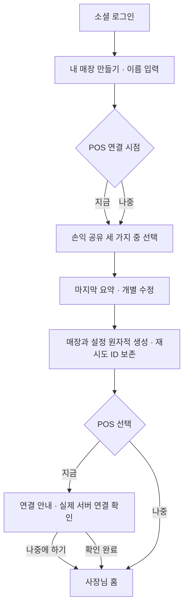

# 최초 설정: POS 선택과 손익 공유

> **현재 상태 · 2026-10-23:** 최초 설정·손익 공유 SQL을 원격 적용하고 toss-proxy v18 ACTIVE를 확인했다. 아래 미실행 서술은 당시 기록이다. 최신 근거는 [SQL 원격 적용 확인](SQL-원격적용-확인-2026-10-23.md)을 따른다.

2026-10-22 사용자 결정에 따른 설계 및 로컬 구현 현황. 앱 코드·마이그레이션을 작성하고 iOS 시뮬레이터에서 화면을 확인했다. **새 SQL 원격 적용과 toss-proxy 재배포는 미실행**이며, 실제 구성원 계정의 서버 권한 검증은 남아 있다.

구현 흐름은 질문을 먼저 마친 뒤 매장을 한 트랜잭션으로 생성한다. POS 지금/나중 선택 → 손익 공유 → 마지막 확인 → 생성 성공 → 지금이면 POS 안내, 나중이면 홈으로 이동한다. 외부 연결을 오가는 동안 미완료 매장이나 중복 매장이 생기지 않도록 한 순서다.

## 1. 사장님 최초 설정 흐름

- 사업자번호 직접 입력은 최초 가입의 필수 조건으로 두지 않는다.
- POS를 나중에 연결해도 설정을 마치고 사용할 수 있다. 지금 연결을 골라도 현장 작업·인증을 완료할 수 없으면 나중으로 미루고 계속한다.
- POS 연결 완료는 실제 서버 연결을 확인했을 때만 표시한다. 선택·안내 확인을 연동 성공으로 저장하지 않는다.
- 서비스코드 설치와 Rattle 계정/매장 연결은 별개의 확인 과정이다. 무번호 안전 연결 방식은 토스 인증 수단 확인 후 구현한다. 설치 시각·매장명만으로 자동 소유 연결하지 않는다.
- 연결 작업을 오가도 매장명과 선택 답변을 유지한다. 저장 실패 시 답변을 보존하고 재시도하며, 생성 완료된 매장을 다시 INSERT하지 않는다.
- 손익 공유 선택은 명시적으로 받는다. 선택하지 않은 상태를 ‘모두 공유’로 해석하지 않는다. 정책 확정 전에는 서버에 임시 매장을 만들지 않고, 마지막 확인에서 매장과 정책을 함께 생성한다.
- 매장 생성·설정 저장·재진입이 중복 매장이나 초기 설정 건너뛰기를 만들지 않도록 완료 상태를 저장한다.

## 2. 실제 질문과 선택지

**매출 자동 연동을 지금 할까요?**

- `지금 연결하기`: 손익 공유와 최종 확인을 마치고 매장 생성 후 POS 연결 안내로 이동
- `나중에 연결하기`: 손익 공유 질문으로 진행하고 매장 생성 후 홈으로 이동

**매장 손익을 누구와 공유할까요?**

안내: ‘선택한 구성원에게 매장 손익 요약과 영업이익을 보여줘요. 다른 사람의 급여 내역은 공유하지 않아요.’

- `직원만`: 승인된 월급제 직원에게 공유
- `직원과 파트타이머`: 승인된 두 근무 형태 모두에게 공유
- `공유 안 함`: 소유자·관리자만 조회

현재 타입의 `regular`를 직원, `part_time`을 파트타이머로 구분한다. 관리자 권한과 고용형태는 별개다. 소유자 또는 승인된 admin은 고용형태와 무관하게 기존 관리자 권한을 유지한다.

## 3. 매장별 손익 요약 권한

| 매장 설정 | 소유자·관리자 | 승인된 직원 | 승인된 파트타이머 |
|---|---|---|---|
| 직원만 | 표시 | 표시 | 숨김 |
| 직원과 파트타이머 | 표시 | 표시 | 표시 |
| 공유 안 함 | 표시 | 숨김 | 숨김 |

- 공유 범위는 해당 매장의 손익 요약·영업이익·마진·관련 추이와 그 안의 매출/매입/총 인건비/비용 합계다. 관리자 전용 상세 손익·전체 매장 대시보드를 직원에게 개방하는 설정은 아니다.
- 개인 급여·공제·계좌·급여 이력은 기존 본인/관리자 권한을 유지한다. 매장 총 인건비 공유가 타인 급여 상세 공유를 뜻하지 않는다.
- 고용형태는 관리자가 최종 합류 처리한 연결 직원의 현재 조건을 기준으로 서버에서 판정한다. 직원이 신청 화면에서 고른 값이나 클라이언트가 보낸 role을 권한 근거로 사용하지 않는다.
- 승인 대기·거절·소속 해제·퇴사·직원 미연결·고용형태 판별 실패는 재무 조회를 허용하지 않는다. 연결이 불분명하다고 직원으로 간주하지 않는다.
- 한 계정이 여러 매장에 소속돼 있으면 각 매장의 정책과 고용형태로 따로 판정한다.

## 4. 직원·파트타이머 화면 분기

| 구성 요소 | 손익 공유 허용 | 손익 공유 미허용 |
|---|---|---|
| 손익 요약·영업이익·마진·금액 추이 | 표시 | 제거 |
| 체크리스트 | 표시 | 표시 |
| 스케줄표 | 표시 | 표시 |
| 본인 급여·근무시간 제출·처리 상태 | 본인만 표시 | 본인만 표시 |
| 재고 조회·수량 수정 | 기존 업무 권한 범위에서 유지 | 기존 업무 권한 범위에서 유지 |
| 다른 직원 급여·계좌·공제 | 숨김 | 숨김 |
| 관리자 상세 손익·관리 기능 | 기존 관리자 전용 | 기존 관리자 전용 |

미허용 구성원의 홈은 체크리스트·스케줄·본인 급여·재고 업무가 중심이다. 재무 카드 자리에는 빈 박스나 ‘권한 없음’ 경고를 반복해서 두지 않고 업무 내용을 배치한다. 신규 메뉴 이름·조작 문구는 기존 화면과 맞춘다. 출퇴근/GPS 기능을 추가하는 결정은 아니다.

허용 구성원의 홈에는 같은 업무 요소와 허용된 손익 컴포넌트를 함께 제공한다. POS 미연결 여부로 손익 공유 권한을 결정하지 않는다. 연결 여부와 관계없이 허용된 사용자에게 수기 입력 등 실제 집계가 있으면 표시한다. 미입력·미확인·조회 실패를 확정 0원으로 표시하지 않는다.

## 5. 보안·설정 변경 기준

- 표시 여부만 바꾸지 않고 집계 RPC·원천 테이블 RLS·상세 경로·알림·캐시까지 같은 정책으로 통제한다. 현재 승인 구성원 전체에게 허용된 홈 집계 RPC는 변경 대상이다.
- 미허용 계정은 손익 API를 호출하지 않으며, 서버에서도 요청을 거부한다. 직접 호출, 다른 화면 진입, 기존 캐시로 손익을 볼 수 없어야 한다.
- 매출·매입·비용 전체 조회로 숨긴 재무 합계를 재구성할 수 있는 우회 경로도 확인한다. 본인 급여와 허용된 재고 업무는 별도 권한으로 유지한다.
- 매장별 설정을 서버에 저장한다. `financial_share_scope = regular_only | all_staff | none`을 사용하며 앱 로컬 설정으로만 관리하지 않는다.
- ‘더보기 → 매장 설정 → 손익 공유’에서 소유자가 변경하는 흐름을 권고한다. 기존 관리자의 정책 변경 권한 확대는 이번 사용자 결정에 포함하지 않는다.
- 공유 범위를 줄이거나 소속·고용형태가 바뀌면 열린 재무 화면과 캐시를 무효화하고 다음 요청부터 서버가 새 정책을 적용한다. 앱이 다시 활성화될 때도 재확인한다.
- POS 연결은 계정에 매장 관리 권한이 있는지 별도로 확인한다. 직원·파트타이머에게 손익을 공유해도 POS 연결·매장 설정 변경 권한은 추가하지 않는다.
- 기존 매장은 `all_staff`로 현재 공유 범위를 유지한다. 새 매장은 기본 `none`이며 마법사에서 명시적으로 선택한 정책을 생성과 함께 저장한다. 기존 매장·급여 원본은 삭제·보정하지 않는다.

## 6. 구현 및 검증 항목

### 구현

- `StoreSetupWizard`: 이름 → POS 시점 → 공유 대상 → 요약. 질문별 입력, 고정 하단 액션, 뒤로가기 보존. 계정별 로컬 초안에는 이름·선택·요청 ID만 저장하고 급여/금액은 저장하지 않는다.
- `create_store_with_setup`: 서버가 로그인 사용자 소유자로 생성한다. 계정+요청 UUID 잠금과 유일 인덱스로 응답 유실·재시도 중복을 방지한다. 생성 요청 후에는 입력을 고정하고 앱 재시작 시 요약에서 같은 요청을 재시도한다. 이후 수정은 매장 설정에서 한다.
- `refreshStore(newId)`: 최신 목록에서 새 매장을 선택한다. 생성 직후 오래된 로컬 목록에서 ID를 찾지 못하던 오류를 해결했다.
- `can_read_store_financials`: 소유자/승인 관리자 또는 정책이 허용한 승인 구성원+활성 연결 직원만 허용한다. 신청자가 작성한 고용형태는 사용하지 않는다.
- raw 금융 테이블 6개 restrictive RLS, 집계·POS·매입 SECURITY DEFINER 함수 진입 검사, 금융 알림 SELECT 정책과 클라이언트 필터, 직접 경로/탭/빠른 등록 제한을 적용했다. 본인 급여와 재고·체크리스트·스케줄 권한은 유지한다.
- `AuthContext.canReadFinancials`와 `useStorePermissions.canReadFinancials`가 같은 서버 판정을 쓴다. 권한 RPC 실패/부재는 구성원 재무를 숨긴다. 앱 활성 복귀 및 활성 상태 30초마다 재확인하며 권한/정책 변경 시 메모리 쿼리를 제거한다. 서버는 다음 요청부터 거부한다. 다른 기기에서 이미 표시된 UI 반영에는 재확인까지 최대 약 30초가 걸릴 수 있다.
- 소유자는 더보기 → 손익 공유 또는 매장 정보 → 손익 공유에서 변경한다. 관리자는 조회 권한을 유지하지만 공유 범위 변경은 소유자만 허용한다.
- 홈 집계는 v2를 사용해 급여 조건 누락을 0원으로 보정하지 않는다.

### 검증

- 타입 검사, Jest 전체 59개 스위트·377개 테스트 통과(후속 변경 시 재실행 수치 우선).
- `npm run test:sql`: 기존 운영/배포/읽기모델/POS 검사와 새 권한 조합 408+ 검증 통과. 축약 가상 스키마이며 원격 정의 대조를 대체하지 않는다.
- 코드 리뷰에서 단계 연타, 생성 응답 유실 후 다른 선택으로 재시도, 제출된 초안 재시작 문제를 발견하고 수정·회귀 테스트했다.
- 네이티브 확인과 이미지: [시뮬레이터 기록](design/store-setup-2026-10-22/README.md).

### 디자인 후속 보완 · Hallmark + UI/UX Pro · 2026-10-23

<!-- Hallmark · pre-emit critique: P4 H4 E4 S5 R5 V4 -->

기존 로고 블루 바탕·컴포넌트별 배경·Wanted Sans/Geist 체계를 따랐다. 사업자번호/권한 정책과 생성 요청 ID·중복 방지 계약은 변경하지 않았다.

- POS 시점과 공유 대상은 같은 선택 카드·명확한 체크 상태·접근성 이름·누름 반응을 사용한다. 공유하지 않는 개인 급여·공제·계좌와 관리자 상세 손익도 짧게 안내한다.
- 최종 요약에서 항목 하나를 수정하면 `수정 완료`로 요약에 바로 돌아온다. 이름을 비우면 해당 질문에서 안내한다. 질문 이동 시 키보드를 닫고 스크롤 위치를 초기화한다.
- 공유 설정은 대상 매장·적용 중인 범위·저장할 범위를 구분한다. 변경 없으면 저장을 막고, 미저장 이동을 확인한다. 저장 성공 뒤 재조회 실패는 저장 실패로 표시하지 않는다.
- POS 최초 안내에는 대상 매장과 하단 고정 시작 버튼을 표시한다. 서버 확인 전에는 연결 완료로 표시하지 않으며, 늦은 다른 매장의 응답을 무시한다. 같은 매장의 진행 중 조회는 중복 폴링하지 않는다.
- 회귀 검사: 정상 저장 후 AuthContext 반영에도 완료 안내 유지, 응답 지연/갱신 실패, 이름을 비운 요약 복귀, 항목 수정 직후 요약 복귀. 전체 Jest 61개 스위트·386개 테스트 통과(후속 실행 수치 우선), TypeScript 검사 통과.
- Release iPhone 16 Pro/iOS 26.3 Simulator에서 수정 전후 최초 설정과 공유 선택 카드, 기존 초안 보존, 요약의 개별 수정·직접 복귀를 확인했다. 생성·정책 저장은 실행하지 않았다. 소유자 공유 설정의 저장 상태는 모의 서비스 회귀 검사이며 실제 소유자 계정/서버 검증을 대신하지 않는다.
- 최종 Release 설치본의 일반 POS 설정에서 대상 매장과 서버에 저장된 연결 상태 표시를 확인했다. 신규 매장 생성 이후의 고정 시작 버튼은 모의 서비스 테스트 범위이며, 기존 매장의 연결을 해제하거나 새 연결을 만들지는 않았다.
- 이번 후속 디자인 변경에는 새 SQL이 없다. 아래 기존 원격 미적용 SQL과 toss-proxy 배포 상태는 그대로다.

## 7. 원격 적용 순서와 남은 범위

사용자가 SQL을 적용하기 전까지 신규 매장 생성 RPC와 서버 공유 제한은 운영에 반영되지 않는다. 기존 매장과 급여를 보정하는 작업은 하지 않았다.

선행 운영 SQL이 적용된 환경에서 다음 순서로 적용한다. 이미 적용한 파일은 재실행하지 않고 현재 정의를 확인한다.

1. `20261021_home_financial_summary.sql`
2. `20261023120000_read_models_and_integrity.sql`
3. `20261023121000_pos_read_models.sql`
4. `20261023122000_financial_wage_coverage.sql`
5. **이번 추가: `20261023123000_store_setup_financial_sharing.sql`**
6. SQL 적용 후 현재 `supabase/functions/toss-proxy/`를 재배포한다. 새 권한 검사 RPC가 없는 상태에서 먼저 배포하면 관리자 멤버의 POS 호출이 거부될 수 있다.

관련 운영·직원 합류 SQL의 적용 여부는 각 기존 문서를 따른다. 이번 SQL은 합류 신청·급여·급여 조건 이력에 DML을 실행하지 않는다.

적용 후 실제 직원·파트타이머 계정으로 세 정책, 타인 급여 차단, 직접 금융 RPC/원천 조회 거절, 다른 매장 격리, 공유 해제/활성 복귀, 실제 생성 성공 응답 유실 후 재시도를 확인한다. 시뮬레이터의 관리자 미리보기는 이 검증을 대신하지 않는다.

**POS 한계:** 서비스코드 설치와 계정 소유 연결은 별개다. 기존 웹훅은 저장된 사업자번호 매칭을 사용하므로 사업자번호 없는 신규 매장을 서비스코드만으로 안전하게 자동 연결하는 서버 절차는 아직 완성되지 않았다. 이번 구현은 시점 선택·안내·나중에 하기·실제 merchant ID 확인까지이며 자동 계정 연결 완료로 보고하지 않는다. 매장명/설치 시각 추정으로 임의 연결하지 않는다.
