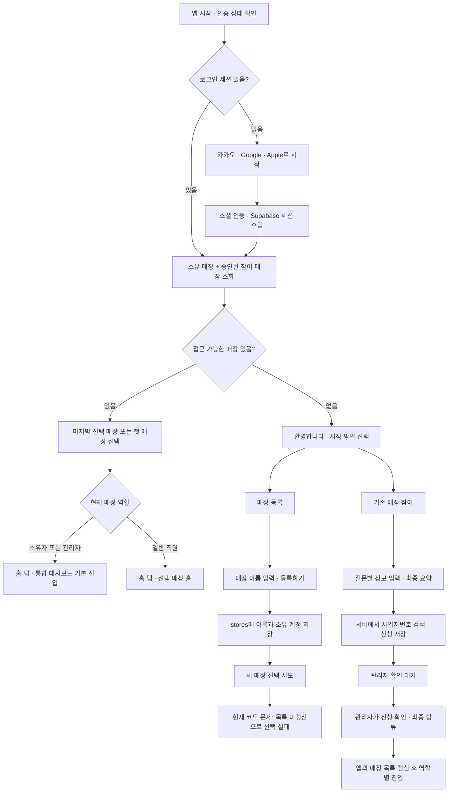

# 회원가입부터 첫 매장 생성·참여까지 현재 흐름

점검: 2026-10-22. `feature/operations-workflows`, HEAD `679c075` 및 **수정·미추적 파일을 포함한 현재 작업 트리** 기준이다. 앱·DB 로직은 변경하지 않았다. 원격 Auth 설정·DB 정의·새 계정의 네이티브 가입을 직접 검증한 기록은 아니다.

후속 사용자 결정: POS 지금/나중에 연결과 손익 공유 대상 3가지 분기를 추가하기로 했다. [새 흐름·권한 설계](최초설정-POS선택과-손익공유-설계-2026-10-22.md)를 따른다. 아래는 변경 전 코드 점검 기록이다. 새 분기는 로컬 구현·시뮬레이터 확인을 마쳤으며 새 SQL과 서버 함수 배포는 미실행이다. 현재 적용 내용은 위 문서의 구현 현황을 따른다.

## 전체 흐름

매장 등록이 의도하는 마지막 동선은 새 매장 선택 → 홈 탭의 통합 대시보드다. 현재 코드에서는 그 직전 선택 처리에 문제가 있다. 기존 회원도 매장 관리 화면에서 새 매장을 추가하거나 기존 매장 참여를 신청할 수 있다.

## 1. 회원가입과 로그인

- 별도 이메일·비밀번호 회원가입 폼이 없다. 소셜 인증을 신규/기존 회원 공통 진입으로 사용한다. 실제 신규 계정 허용 여부와 계정 연결 방식은 원격 Supabase Auth 설정도 확인해야 한다.
- 카카오·Google은 브라우저 인증 후 콜백을 처리한다. iOS Apple은 기본 인증을 사용한다.
- 로그인 화면에는 세 버튼이 모두 표시된다. Apple 버튼은 플랫폼 조건 없이 렌더링하며, 서비스에서는 iOS 외 플랫폼이 OAuth 분기로 들어간다. “iOS에서만 제공”이라는 프로젝트 지침과 이 부분은 일치하지 않는다.
- 약관·개인정보처리방침 링크와 “계속 진행 시 동의” 문구가 있다. 별도 체크박스·약관 버전별 동의 저장 단계는 이 화면과 인증 코드에 없다.
- 소유 매장과 `approved` 참여 매장을 병합해 조회한다. 저장된 마지막 매장이 접근 가능하면 선택하고, 아니면 첫 접근 가능 매장을 선택한다. 승인 대기 매장은 접속 가능한 목록에 포함하지 않는다.

근거: [로그인 화면](../app/(auth)/login.tsx), [인증 서비스](../lib/services/socialAuth.ts), [콜백](../lib/services/authCallback.ts), [AuthContext](../lib/contexts/AuthContext.tsx), [최상위 라우팅](../app/_layout.tsx).

## 2. 사장님의 첫 매장 등록

| 순서 | 실제 화면·처리 | 저장 시점 |
|---|---|---|
| 1 | ‘환영합니다’에서 ‘매장 등록’ 선택 | 저장 없음 |
| 2 | 매장 이름 입력 | 화면 메모리만 변경 |
| 3 | ‘등록하기’ | `stores`에 `name`, `owner_id` INSERT |
| 4 | 반환된 매장 ID로 `switchStore` 호출 | 목록에서 찾은 매장만 기기의 마지막 선택값과 현재 매장으로 저장 |
| 5 | 성공하면 홈 탭 이동 | 소유 계정은 관리자 역할, 기본 홈은 통합 대시보드 |

필수 입력은 **매장 이름 하나**다. 사업자번호, 대표자명, 연락처, 업종, 주소, POS 선택·연결, 정산 시간, 비용·직원 등록을 묻는 첫 설정 과정은 없다. 별도 사장님/직원 역할 질문도 없고 시작 방법의 선택으로 갈린다. 본인 계정으로 만든 매장의 `owner_id`가 관리자 판단 기준이 된다. 직원 레코드나 월 급여가 자동 생성되는 것은 아니다.

등록 뒤 매장 정보 화면에서 수정할 수 있는 것은 이름·주소이며, 일 정산 시간은 매출 설정으로 연결한다. 로컬 SQL의 기본 정산 시간은 23:00이다. 사업자번호·대표 연락처 컬럼과 서비스의 수정 타입은 있지만 현재 매장 정보 화면에 입력란이 없다.

근거: [매장 생성](../app/(auth)/select-store.tsx), [선택 처리](../lib/contexts/AuthContext.tsx), [매장 정보](../app/settings/store.tsx), [설정 서비스](../lib/services/stores.ts), [관리자 기본 홈](../app/(tabs)/_layout.tsx).

## 3. 직원의 기존 매장 참여

현재 질문 순서는 다음과 같다. 매장 등록 흐름과 별개다.

1. 이름
2. 휴대폰 번호
3. 사업자번호 10자리
4. 근무 형태: 직원(월급제) / 파트타이머(시급제)
5. 월급제: 월 기본급 → 비과세 / 시급제: 시급 → 주 근무시간
6. 입사일
7. 은행
8. 계좌번호
9. 최종 요약·항목별 수정 → 신청 제출
10. ‘관리자 확인을 기다려주세요’ → 확인 후 이전 화면으로 복귀
11. 관리자: 멤버 관리 → 신청 확인 → 조건 검토·수정 → 최종 합류
12. 승인된 매장 목록을 갱신하면 해당 매장 접속 가능

- 질문별 이동은 로컬 검증이다. **매장 존재 여부는 사업자번호 질문 직후가 아니라 최종 제출 시 서버에서 확인한다.** 없는 번호나 중복 번호는 마지막 제출에서 실패할 수 있다.
- 휴대폰 번호는 형식 확인이며 SMS 본인인증 단계는 없다. 사업자번호도 매장 조회용이며 소유자 본인인증을 뜻하지 않는다.
- 최종 제출 전 답변은 화면 메모리다. 질문 사이 뒤로가기에서는 보존하지만 앱 종료 후 임시저장·복원을 제공하는 흐름은 아니다.
- 제출은 `store_members`의 대기 신청과 `store_join_profiles`에 기록한다. 관리자 최종 합류 전에는 최종 직원 조건·인건비에 반영하지 않는다.
- 최종 합류 시 직원 연결·조건·급여 이력을 처리하며, 중복·퇴사 사례는 관리자 선택을 거친다. 기존 급여 기록을 보존하고 월 급여 명세를 자동 작성하지 않는다.
- 승인 대기 전용 목록/승인 즉시 자동 진입 경로는 이 가입 화면에서 확인되지 않는다. 매장 선택 화면 포커스 시 재조회하거나 다시 로그인하는 등 목록 갱신이 필요하다.
- 이 흐름의 `20261022_employee_join_onboarding.sql`은 프로젝트 문서상 원격 미적용이다. 실제 서버에서 제출·승인이 가능한지는 별도 확인이 필요하다.

근거: [질문 화면](../app/(auth)/join-store.tsx), [질문 순서](../lib/utils/joinFlow.ts), [서비스](../lib/services/storeMembers.ts), [SQL](../supabase/migrations/20261022_employee_join_onboarding.sql), [기존 적용 기록](직원-합류-온보딩-2026-10-22.md).

## 4. 현재 흐름에서 확인한 단절

### 우선: 매장은 생성되지만 다음 화면으로 이동하지 못함

`handleCreateStore`는 DB INSERT 직후 새 ID로 `switchStore`를 호출한다. 그런데 `switchStore`는 현재 `stores` 배열에 있는 매장만 선택한다. 생성 후 목록을 갱신하거나 새 매장을 배열에 추가하는 처리가 없다.

현재 두 함수를 그대로 추출해 DB만 모킹한 격리 실행에서 **INSERT 성공 → ‘매장 목록을 다시 확인해주세요.’ 오류 → 라우팅 미실행**을 확인했다. 실제 서버에 매장을 만들지 않았다. 실패 안내가 떠도 DB 생성은 끝난 상황이므로 재시도하면 중복 매장이 생길 수 있다. 화면 복귀·재로그인 등으로 목록을 다시 읽으면 이미 생성된 매장이 나타날 수 있다.

권고: 생성 성공 결과와 목록·선택 상태를 연결하고, 생성 후 선택만 실패한 경우 신규 INSERT 재시도가 아닌 기존 생성 매장으로 복구해야 한다. 이번 점검에서는 수정하지 않았다.

### 우선: 사업자번호를 저장하는 사용자 동선이 없음

신규 매장 생성에는 사업자번호가 없고, 매장 정보 화면에도 입력란이 없다. 반면 직원 참여와 토스 설치 웹훅은 `stores.business_number`를 기준으로 매장을 찾는다.

따라서 현재 앱만으로 이름만 등록한 신규 매장은 직원의 사업자번호 신청과 토스 자동 매칭으로 자연스럽게 이어지지 않는다. 기존에 서버에서 사업자번호가 채워진 매장은 다르게 동작할 수 있다. 토스 연결 화면의 “따로 입력할 내용이 없다”는 설명도 신규 생성 흐름과 맞지 않는다. 토스 미매칭 이벤트는 서버 대기 큐에 보관하도록 작성돼 있다.

권고: 매장 등록 과정 또는 연결 전 설정에 사업자번호 입력·확인과 중복 처리, 안전한 소유 매장 연결 단계를 넣어야 한다. POS 연결은 선택 단계로 두되 미연결 상태를 명확히 표시한다.

근거: [POS 안내 화면](../app/settings/pos-sync.tsx), [사업자번호 매칭 SQL](../supabase/migrations/20261020_03_webhook_transaction.sql).

### 그 밖의 확인 사항

- Auth 레이아웃에는 `signup` 화면 선언이 남아 있지만 실제 `signup.tsx`는 없다. 실제 가입 동선은 소셜 시작이다.
- 매장 생성 화면은 서비스 레이어 대신 직접 Supabase INSERT를 호출한다. 프로젝트의 DB 접근 규칙과 일치하지 않는다.
- 사업자번호 확인이 질문 마지막까지 미뤄지고, 승인 대기 상태를 다시 확인하는 동선도 약하다.

## 검증과 범위

- 수정된 로그인·루트·AuthContext·직원 참여 화면과 미추적 인증 서비스·질문 유틸·온보딩 SQL을 포함해 읽었다. `select-store.tsx`는 HEAD와 차이가 없지만 현재 연결된 AuthContext와 함께 점검했다.
- 기존 관련 테스트 5개 suite, 38개 통과: AuthContext, LoginScreen, JoinStoreOnboarding, socialAuth, joinOnboarding.
- 테스트 통과가 최초 생성 이후 진입 성공을 뜻하지 않는다. 기존 테스트에 없는 생성/선택 연결 문제는 위 격리 실행으로 별도 확인했다.
- 실제 외부 회원가입·운영 DB INSERT·네이티브 신규 계정·원격 SQL 적용은 수행하지 않았다. 소스와 흐름을 점검했으며 앱 기능 수정은 하지 않았다.
